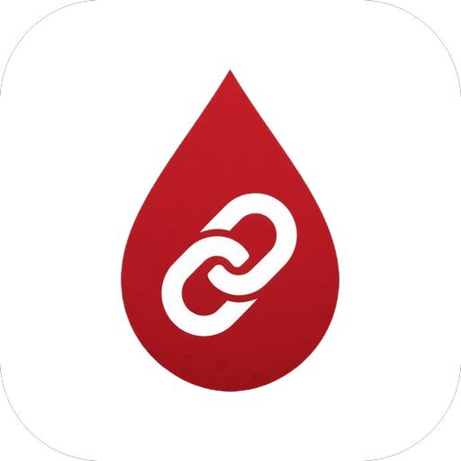

<p align="center">
  
</p>

<h1 align="center">BloodLink Android</h1>

<p align="center">
  <strong>Native Android Client for Real-Time Blood Donation & Matching</strong>
</p>

<p align="center">
  
  
  
  
  
  
  
</p>

---

## Overview

**BloodLink Android** is the native mobile front-end for the BloodLink platform. Built with Kotlin and modern Android architecture components, it enables users to register as blood donors, post urgent blood requests, communicate through real-time 1-on-1 chat, and receive instant push notifications when matching requests are published.

---

## Features

### 🔐 Authentication & Profile
- Email and password registration via Firebase Authentication
- Email verification flow prior to account activation
- Persistent login session management
- Blood group registration and donor profile management
- Availability switch (Active / Temporarily Unavailable)
- Cooldown safety window enforcement (56-day donation interval)

### 🩸 Blood Requests
- Create blood requests with patient details, hospital info, blood units, and district
- Date and time pickers for scheduled donations
- Intelligent donor matching by blood group and geographic location
- Request status lifecycle tracking (`open` ➔ `matched` ➔ `fulfilled`)

### 💬 Real-Time In-App Chat
- Instant 1-on-1 messaging between donor and recipient
- **WhatsApp-style delivery indicators**:
  - Sent (single tick)
  - Delivered (double tick)
  - Read (double blue tick)
- Direct phone call integration for time-sensitive emergencies

### 🔔 Notifications
- Background and foreground push notifications powered by Firebase Cloud Messaging (FCM)
- In-app notification center with read/unread tracking
- Offline caching and automatic resynchronization upon reconnection

### 🎨 Material 3 Design
- BloodLink deep-crimson theming (`#C62828`)
- Modern bottom navigation bar with active indicators
- Card-based layouts with rounded corners and consistent typography

---

## Tech Stack

| Library / Tool | Purpose |
|---|---|
| Kotlin 1.9+ | Primary programming language |
| MVVM Architecture | Separation of presentation, state, and data logic |
| Android Navigation Component | Single-activity in-app fragment routing |
| View Binding | Compile-time safe view access |
| Firebase Authentication | User account lifecycle and token management |
| Cloud Firestore | Real-time database and message synchronization |
| Firebase Cloud Messaging (FCM) | Push notification delivery |
| Retrofit 2 + OkHttp 3 | REST API integration with the NestJS backend |
| Timber | Robust application logging |

---

## Project Structure

```
android-app/
│
├── app/
│   ├── src/main/
│   │   ├── java/com/project/donateblood/
│   │   │   ├── activities/          # MainActivity and root navigation
│   │   │   ├── adapters/            # RecyclerView & ViewPager adapters
│   │   │   ├── fragments/           # UI screens (Home, Chat, Request, Profile)
│   │   │   ├── model/               # Data classes (User, BloodRequest, ChatMessage)
│   │   │   ├── network/             # Retrofit interfaces & API service clients
│   │   │   ├── repository/          # Firestore and remote repositories
│   │   │   ├── viewmodel/           # MVVM ViewModels
│   │   │   └── utils/               # Constants, formatters, and helpers
│   │   │
│   │   └── res/
│   │       ├── layout/              # XML layout definitions
│   │       ├── navigation/          # Jetpack Navigation graphs
│   │       ├── drawable/            # Vector drawables & brand assets
│   │       └── values/              # Colors, styles, strings, themes
│   │
│   ├── google-services.json         # Firebase config (gitignored)
│   └── build.gradle.kts
│
└── build.gradle.kts
```

---

## Getting Started

### Prerequisites
- **Android Studio** Ladybug (2024.2+) or later
- **JDK 17** or **JDK 21**
- Physical Android device or Emulator running **API 26 (Android 8.0)** or higher
- A Firebase project with Auth, Firestore, and FCM configured

### Installation

1. **Clone the repository**:
   ```bash
   git clone https://github.com/mashudhahmed/blood-donation-mobile-app.git
   cd blood-donation-mobile-app
   ```

2. Open the `android-app/` folder in Android Studio.
3. Download `google-services.json` from your Firebase Console and place it in `android-app/app/`.
4. Check the backend endpoint in `app/src/main/java/com/project/donateblood/utils/Constants.kt`:
   ```kotlin
   object Constants {
       const val BASE_URL = "http://10.0.2.2:3000/" // Android Emulator
       // or your live backend URL
   }
   ```
5. Build and install to your attached device:
   ```bash
   ./gradlew assembleDebug
   ```

---

## License

This project is licensed under the [MIT License](../LICENSE).  
Developed for educational, portfolio, and humanitarian impact purposes.
